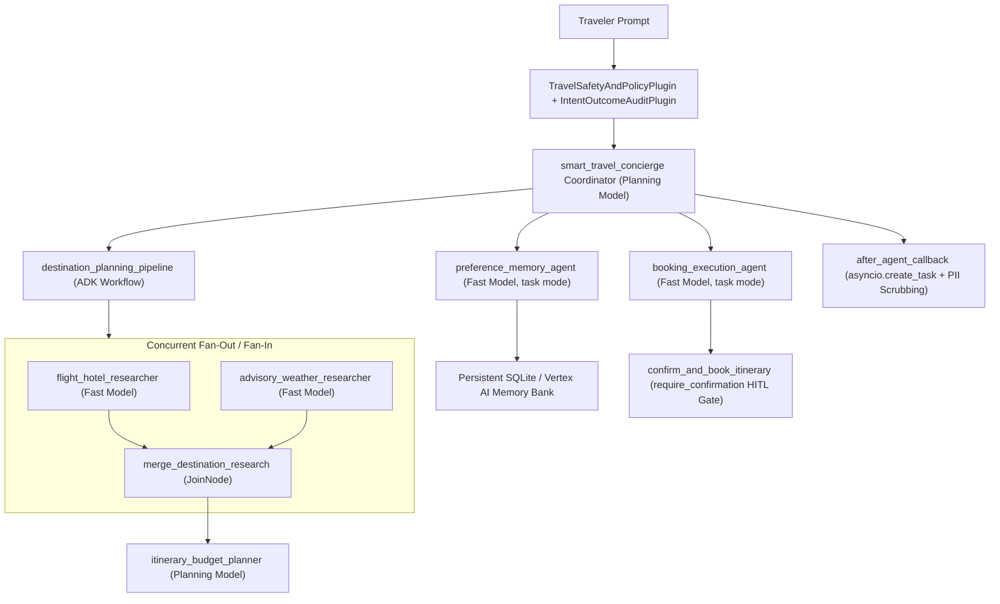

# VoyagerAI: Smart Travel & Budget Concierge

**VoyagerAI** (`smart-travel-concierge-l300`) is a multi-agent travel planning and booking concierge built with **Google Agent Development Kit (ADK-Python 2.x)** and **Google Agents CLI (`agents-cli`)**. It solves the tedious problem of coordinating flight/lodging inventory, destination advisories, strict budget math, cross-session traveler preferences, and high-stakes reservations across separate apps.

## Architecture



## AgentOps Implementation Highlights

- **Tool & Interface Design (`app/tools/`, `app/schemas.py`)**: Verb-noun tool names (`search_verified_flights_and_hotels`, `check_destination_travel_advisories`, `calculate_trip_budget_breakdown`, `retrieve_traveler_preferences`, `save_traveler_preference`, `confirm_and_book_itinerary`), comprehensive Google-style docstrings, strict Pydantic v2 JSON schemas (`extra="forbid"`), and structured `GuidedErrorResponse` recovery payloads.
- **Context & Memory (`app/prompts.py`, `app/memory/`, `app/app_utils/services.py`)**: `<CONSTITUTION>` instructions, ADK `EventsCompactionConfig` (`LlmEventSummarizer`) + `ContextCacheConfig` + `ContextFilterPlugin` sliding-window filter, persistent `DatabaseSessionService` + `SqliteMemoryService` (or `VertexAiSessionService` / `VertexAiMemoryBankService` on Agent Engine), `PreloadMemoryTool`, and non-blocking `asyncio.create_task` memory extraction.
- **Orchestration & Logic (`app/agent.py`, `app/routing.py`, `app/guardrails.py`)**: Coordinator + parallel `Workflow`/`JoinNode` + task sub-agents, strategic `ModelRouter` routing Flash vs. Pro models, `TravelSafetyAndPolicyPlugin` (prompt-injection checks, output PII filter, optional Cloud Model Armor) + `ReflectAndRetryToolPlugin`, and ADK `require_confirmation` HITL booking gate with `ResumabilityConfig(is_resumable=True)`.
- **Observability & Security (`app/observability/`, `app/security/`)**: `python-json-logger` structured JSON logs, paired `TOOL_INTENT` / `TOOL_OUTCOME` and `MODEL_INTENT` / `MODEL_OUTCOME` audit records, OpenTelemetry distributed tracing (`AutoTracingPlugin` + `CloudTraceSpanExporter`), active `PiiRedactor` (regex + optional Google Cloud DLP), and `SecretManagerConfig` (`google-cloud-secret-manager` with environment variable fallback).
- **Infrastructure, Eval & CI/CD (`deployment/terraform/`, `tests/`, `.github/workflows/ci.yml`)**: Terraform IaC for Agent Runtime, IAM, Secret Manager, Cloud Trace, and BigQuery telemetry; automated `pytest` unit/integration tests; golden evaluation suites; and GitHub Actions CI.

## Project Structure

```text
smart-travel-concierge-l300/
├── app/
│   ├── agent.py                  # Coordinator, Workflow, sub-agents, and ADK App
│   ├── guardrails.py             # TravelSafetyAndPolicyPlugin (input/output & Model Armor)
│   ├── prompts.py                # <CONSTITUTION> system instructions
│   ├── routing.py                # Strategic Flash vs. Pro ModelRouter
│   ├── schemas.py                # Strict Pydantic v2 input/output/error schemas
│   ├── fast_api_app.py           # FastAPI + A2A + Reasoning Engine HTTP server
│   ├── app_utils/services.py     # Persistent DatabaseSessionService & SqliteMemoryService
│   ├── memory/                   # Persistent store, async tasks, and compaction helpers
│   ├── observability/            # JSON logging, OTel tracing, and Intent/Outcome audit
│   ├── security/                 # PiiRedactor (regex + Cloud DLP) and SecretManagerConfig
│   └── tools/                    # Travel search, advisories, budget math, memory, HITL booking
├── deployment/terraform/         # Terraform IaC (Agent Runtime, Secret Manager, IAM, Telemetry)
├── tests/
│   ├── unit/                     # Deterministic unit tests for tools, schemas, PII, compaction
│   ├── integration/              # Offline multi-turn E2E tests (FakeLlm) & live server tests
│   └── eval/                     # Golden dataset & LLM-as-judge eval config
├── .github/workflows/ci.yml      # Ruff, ty, codespell, pytest, and Terraform validation
├── Dockerfile
├── Makefile
└── pyproject.toml
```

## Quick Start

### 1. Prerequisites

```bash
# Install uv and google-agents-cli
curl -LsSf https://astral.sh/uv/install.sh | sh
uv tool install google-agents-cli

# Install dependencies (including eval and lint extras)
uv sync --extra eval --extra lint
```

### 2. Configure Environment

```bash
cp .env.example .env
# Either authenticate with Google Cloud ADC for Vertex AI / Gemini Enterprise:
#   gcloud auth application-default login
# Or set GOOGLE_GENAI_USE_ENTERPRISE=false and GEMINI_API_KEY=<your-key>
```

Never hardcode API keys or commit `.env`. In production, credentials are stored in Google Cloud Secret Manager and accessed via `app/security/secrets.py`.

### 3. Run Locally

```bash
# Interactive ADK Web Playground
agents-cli playground

# Or run the FastAPI / A2A server directly
uv run uvicorn app.fast_api_app:app --host 0.0.0.0 --port 8000
```

### 4. Test, Lint & Evaluate

```bash
# Run deterministic unit + offline E2E agent tests (no API key required)
make test

# Run linter, formatter check, type checker, and spell check
make lint

# Run golden dataset evaluation with LLM-as-judge (requires ADC or GEMINI_API_KEY)
agents-cli eval run --dataset tests/eval/datasets/travel-golden-dataset.json
```

### 5. Provision Infrastructure & Deploy (Optional Cloud Deployment)

```bash
# Provision GCP resources (Agent Runtime, Secret Manager, Cloud Trace, BigQuery telemetry)
agents-cli infra single-project --project <your-gcp-project-id>

# Deploy agent via agents-cli
agents-cli deploy --project <your-gcp-project-id> --region us-central1
```
